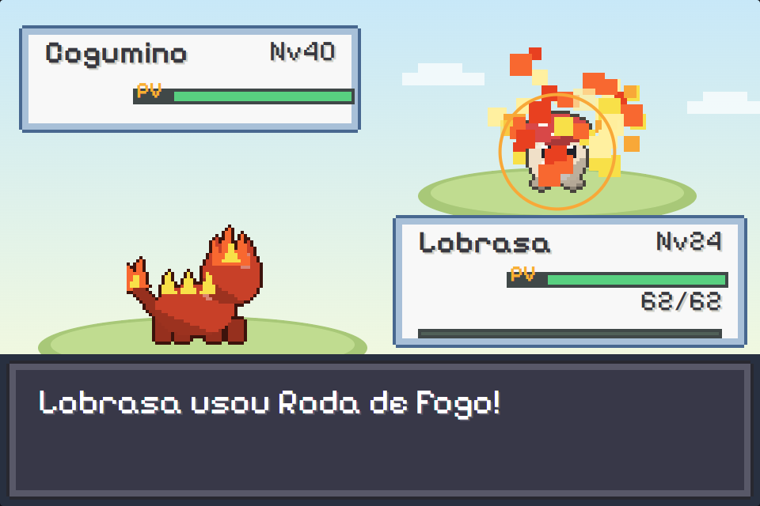

# Aurora: Caçadores de Feras

RPG de captura de criaturas em pixel art, **100% original**: todas as feras, personagens, mapas e a história foram criados do zero. Feito em TypeScript com HTML5 Canvas, empacotado como app para Windows (Electron) e jogável no navegador.

**[Site e demonstração jogável](https://pqueirozdev.github.io/aurora-feras/)** · **[Baixar para Windows](https://github.com/PQueirozDev/aurora-feras/releases/latest)**



## O jogo
- 41 feras com evoluções (até 3 estágios), 13 tipos e cerca de 80 golpes
- 42 mapas: 5 cidades, rotas, bosque, caverna escura, usina e a Estrada da Vitória
- 4 ginásios, a Equipe Eclipse, rival com 4 batalhas, Liga Aurora (Elite + Campeão) e uma fera lendária depois do final
- Efeitos animados por tipo de golpe, apresentação especial dos líderes, créditos e Hall da Fama
- Táxi aéreo entre cidades, Repelente, Compartilhador XP, apelidos, Feradex
- Teclado, controle (Xbox/PlayStation) ou toque na tela; salvamento local

## Controles
| Ação | Teclado | Controle |
|---|---|---|
| Andar | Setas / WASD | Direcional ou analógico |
| Confirmar | Z / Espaço | A |
| Voltar / correr (segurando) | X / Shift | B |
| Menu | Enter | Start |
| Tela cheia (app) | F11 | — |

## Desenvolvimento
```bash
npm install
npm run dev          # joga no navegador (http://localhost:5173)
npm run build        # checagem de tipos + build do jogo
npm run site         # monta o site em site-dist/ (jogo em /jogar)
npm run dist:win     # instaladores do Windows em release/
npx vite-node scripts/check-maps.ts     # valida os mapas (tamanhos, portas, alcance)
npx vite-node scripts/smoke-story.ts    # executa toda a história num mundo simulado
```

## Estrutura
- `src/engine/`: loop, entrada (teclado/toque/controle), tela, áudio, cenas
- `src/gfx/`: tiles, personagens e o gerador de sprites das feras (pixel art feita por código)
- `src/data/`: tipos, golpes, feras, itens e mapas (`src/data/maps/regiao*.ts`)
- `src/scenes/`: mundo, batalha, efeitos, menus, título, evolução, créditos
- `site/`: página de demonstração e download
- `electron/`: janela do app para Windows

O som vem desligado por padrão. Para ligar, mude `SOM_DESATIVADO` em `src/engine/audio.ts`.
